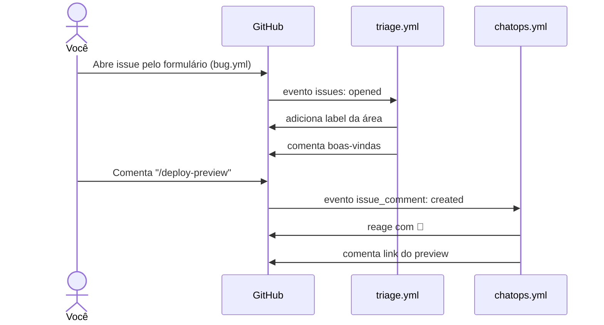

# Oficina de Git & GitHub

Repositório da oficina **Git & GitHub: versionamento, colaboração e boas práticas para projetos de código**, ministrada por Maria Carolina Cabral de Almeida e Murilo de Andrade Souza (Engenharia de Software, UPE, 22/10/2026).

Aqui não há uma aplicação: o "código" do repositório é a pasta [`.github/`](.github), que reúne os recursos do GitHub apresentados na segunda metade da oficina. Este README explica cada um deles para você entender o que acontece quando interage com o repositório e conseguir reproduzir a ideia nos seus próprios projetos.

## Sumário

- [Mão na massa: Caça aos Bots](#mão-na-massa-caça-aos-bots)
- [Estrutura da pasta `.github`](#estrutura-da-pasta-github)
- [Ato 1: entrada estruturada e triagem](#ato-1-entrada-estruturada-e-triagem)
  - [Issue Forms](#issue-forms-githubissue_templatebugyml)
  - [Triagem automática com GitHub Actions](#triagem-automática-githubworkflowstriageyml)
- [Ato 2: IA agêntica e ChatOps](#ato-2-ia-agêntica-e-chatops)
  - [Instruções para agentes de IA](#instruções-para-agentes-de-ia-githubcopilot-instructionsmd)
  - [ChatOps com slash commands](#chatops-githubworkflowschatopsyml)
- [Anatomia de um workflow](#anatomia-de-um-workflow)
- [Como reaproveitar no seu repositório](#como-reaproveitar-no-seu-repositório)
- [Revisão rápida do conteúdo de Git](#revisão-rápida-do-conteúdo-de-git)

## Mão na massa: Caça aos Bots

O exercício final da oficina usa este repositório. São três passos:

1. Dê uma estrela (⭐) no repositório.
2. Abra uma **Issue** usando o template *🐛 Relato de Bug / Tarefa* e encontre o **1º bot (Triagem)**: ele aplica uma label e comenta na sua issue.
3. Comente `/deploy-preview` em um **Pull Request** (ou na sua issue) e encontre o **2º bot (ChatOps)**: ele reage com 🚀 e responde com um link de preview.

O fluxo completo fica assim:



## Estrutura da pasta `.github`

```
.github/
├── ISSUE_TEMPLATE/
│   └── bug.yml                # Issue Form: formulário padronizado para abrir issues
├── workflows/
│   ├── triage.yml             # Bot 1: classifica e dá boas-vindas a cada issue nova
│   └── chatops.yml            # Bot 2: responde ao comando /deploy-preview
└── copilot-instructions.md    # Regras do repositório para o Copilot e outros agentes de IA
```

A pasta `.github` é especial: o GitHub procura nela, por convenção, templates de issues e PRs, workflows do GitHub Actions, instruções para o Copilot e outros arquivos de configuração da comunidade (como `CODEOWNERS` e `CONTRIBUTING.md`). Nada disso precisa ser "ligado" em outro lugar; basta o arquivo estar no caminho certo na branch padrão.

## Ato 1: entrada estruturada e triagem

Uma issue escrita só como "não funciona" custa tempo de quem precisa entendê-la. A ideia deste ato é fazer a issue já **nascer organizada** e deixar uma automação fazer a primeira classificação.

### Issue Forms (`.github/ISSUE_TEMPLATE/bug.yml`)

Arquivos `.yml` dentro de `ISSUE_TEMPLATE/` viram formulários na tela *New issue*. Em vez de um campo de texto livre, quem abre a issue preenche campos com tipo e validação.

| Trecho do [`bug.yml`](.github/ISSUE_TEMPLATE/bug.yml) | O que faz |
| --- | --- |
| `name`, `description` | Nome e descrição do template na lista de escolha |
| `title: "[Bug]: "` | Prefixo que já vem preenchido no título |
| `labels: ["triagem-pendente"]` | Label aplicada automaticamente ao abrir a issue |
| `type: markdown` | Texto informativo, não é um campo |
| `type: dropdown` (`id: area`) | Lista fechada de áreas: Frontend, Backend ou Documentação |
| `type: textarea` (`id: descricao`) | Descrição do problema, com `placeholder` de exemplo |
| `type: checkboxes` (`id: termos`) | Confirmação de que a pessoa procurou issues duplicadas |
| `validations: required: true` | Impede enviar o formulário sem preencher o campo |

O dropdown é o que torna a automação possível: como a área vem de uma lista fechada, o texto que chega no corpo da issue é previsível e um script consegue lê-lo. A descrição também é pensada para ser lida por um agente de IA (veja o [Ato 2](#ato-2-ia-agêntica-e-chatops)), por isso o formulário pede clareza.

### Triagem automática (`.github/workflows/triage.yml`)

Este é o **1º bot**. Ele roda sempre que uma issue é aberta e faz o trabalho que antes exigia alguém lendo cada issue nova:

```yaml
on:
  issues:
    types: [opened]   # dispara quando uma issue é criada

permissions:
  issues: write       # o bot só pode mexer em issues
```

O passo principal usa a action [`actions/github-script`](https://github.com/actions/github-script), que executa JavaScript com um cliente da API do GitHub (`github`) e os dados do evento (`context`) já prontos:

1. **Lê o corpo da issue** em `context.payload.issue.body`.
2. **Descobre a área** procurando o texto da opção escolhida no dropdown e mapeia para uma label:

   | Opção no formulário | Label aplicada |
   | --- | --- |
   | Frontend (Interface) | `🎨 frontend` |
   | Backend (API) | `⚙️ backend` |
   | Documentação | `📚 docs` |
   | nenhuma encontrada | `geral` |

3. **Adiciona a label** com `github.rest.issues.addLabels`.
4. **Comenta boas-vindas** marcando o autor com `github.rest.issues.createComment`.

> [!NOTE]
> A detecção usa `body.includes(...)`, o que é suficiente para a demonstração, mas é uma simplificação: se a descrição citar outra área (por exemplo, "o Backend retorna erro" numa issue de Frontend), a última verificação que bater vence. Em um projeto real vale extrair o valor exato da seção do dropdown no corpo da issue.

## Ato 2: IA agêntica e ChatOps

### Instruções para agentes de IA (`.github/copilot-instructions.md`)

Ferramentas como o **Copilot coding agent** (que recebe uma issue atribuída, cria uma branch, faz commits e abre um PR) e o **Copilot code review** (que revisa PRs) leem o arquivo [`copilot-instructions.md`](.github/copilot-instructions.md) como contexto do repositório. É o equivalente a um guia de contribuição escrito para a IA.

As regras deste repositório cobrem quatro pontos:

- **Idioma:** comentários, mensagens de erro e nomes de variáveis em português (pt-BR).
- **Estilo:** funções puras, `early return` e nada de `var` em JavaScript/TypeScript.
- **Segurança:** nunca concatenar strings em SQL ou comandos de shell; validar entradas no início da função.
- **Testes:** toda função nova vem com pelo menos um teste unitário.

O fluxo apresentado na oficina é: escreva uma issue clara (o Issue Form ajuda nisso) → atribua ao Copilot → o agente trabalha e abre um PR em rascunho → você revisa e comenta → o agente ajusta. O agente não faz merge sozinho: o PR passa pela mesma revisão de qualquer contribuição. **A IA sugere; quem aprova continua sendo uma pessoa.**

### ChatOps (`.github/workflows/chatops.yml`)

Este é o **2º bot**. ChatOps é transformar a conversa de uma issue ou PR em painel de controle: um comentário com um comando dispara uma ação.

```yaml
on:
  issue_comment:
    types: [created]   # dispara a cada comentário novo

jobs:
  slash-command:
    if: startsWith(github.event.comment.body, '/deploy-preview')
```

- O evento `issue_comment` cobre comentários **tanto em issues quanto em Pull Requests**, porque para a API do GitHub todo PR também é uma issue. Por isso o comando funciona nos dois lugares. Para restringir a PRs, como no slide da oficina, basta acrescentar `github.event.issue.pull_request &&` à condição.
- O `if` no nível do job faz o workflow ser ignorado (sem nem subir uma máquina) quando o comentário não começa com `/deploy-preview`.

Quando o comando é reconhecido, o script:

1. Reage ao comentário com 🚀 (`github.rest.reactions.createForIssueComment`), confirmando que o comando foi recebido.
2. Responde com um comentário contendo a URL de preview `https://staging-pr-<número>.meuapp-demo.com`.

> [!IMPORTANT]
> O deploy é **simulado**: nenhum ambiente é criado e o link é fictício. Em um projeto real, esse passo chamaria um script de build e deploy (por exemplo, `./scripts/deploy-preview.sh`) antes de responder.

## Anatomia de um workflow

Os dois bots seguem a mesma estrutura, que serve de modelo para outras automações:

```yaml
name: Nome que aparece na aba Actions

on:                    # QUANDO roda: o evento que dispara o workflow
  issues:
    types: [opened]

permissions:           # O QUE pode fazer: menor privilégio possível
  issues: write

jobs:
  meu-job:
    if: ...            # condição opcional para rodar ou não
    runs-on: ubuntu-latest   # ONDE roda: máquina virtual do GitHub
    steps:             # COMO: lista de passos executados em ordem
      - uses: actions/github-script@v7
        with:
          script: |
            // context = dados do evento; github = cliente da API REST
```

Você acompanha cada execução na aba **Actions** do repositório, com os logs de cada passo. É o primeiro lugar a olhar quando um bot não responder.

## Como reaproveitar no seu repositório

1. Copie a pasta `.github/` (ou só os arquivos que interessam) para a raiz do seu repositório e faça push para a branch padrão.
2. Em **Settings → Actions → General**, confira se o Actions está habilitado. Não é preciso liberar permissões amplas: o bloco `permissions:` de cada workflow já pede só o necessário.
3. Ajuste as opções do dropdown em `bug.yml` e o mapeamento de labels em `triage.yml` para as áreas do seu projeto.
4. Reescreva o `copilot-instructions.md` com as convenções reais do seu time.

## Revisão rápida do conteúdo de Git

A primeira metade da oficina cobriu o Git em cinco blocos. Os comandos principais, para consulta:

| Bloco | Ideia central | Comandos |
| --- | --- | --- |
| 1 · Arquitetura | Três áreas: working directory → staging area → repositório | `git status` |
| 2 · Fluxo e recuperação | Cada passo tem um desfazer | `git add`, `git commit`, `git restore`, `git restore --staged`, `git reset --soft HEAD~1`, `git revert` |
| 3 · Boas práticas | `.gitignore` antes do 1º commit e mensagens no padrão Conventional Commits (`feat:`, `fix:`, `docs:`, `refactor:`, `test:`, `chore:`) | `git rm --cached` |
| 4 · Branches | Trabalho em paralelo; merge preserva o histórico, rebase o deixa linear (nunca faça rebase de branch compartilhada) | `git switch -c`, `git merge`, `git rebase` |
| 5 · Sincronização | `fetch` espia, `pull` baixa e une, `push` envia | `git fetch`, `git pull`, `git push` |

E no GitHub, os quatro pilares: **Repositório + README**, **Issues**, **Fork** e **Pull Request**, no fluxo Issue → Fork → Branch → Pull Request → Merge.

---

Autores: [@muliroZ](https://github.com/muliroZ) e [@CarolinaaCabral](https://github.com/CarolinaaCabral).
